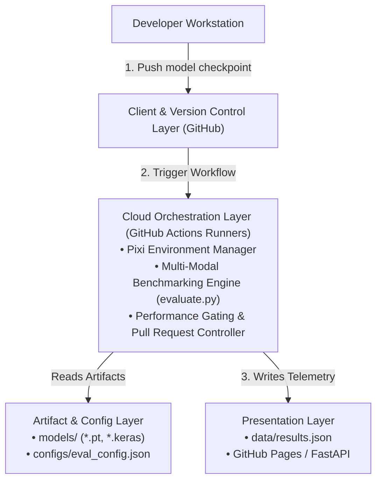

# ModelEval: Automated MLOps Benchmarking & Gating Pipeline

[](https://github.com/sriramxdev/ModelEval/actions)
[](https://pixi.sh)
[](https://pytorch.org)
[](#live-telemetry-dashboard)
[](LICENSE)

An enterprise-grade, deterministic MLOps gating system engineered to continuously benchmark deep learning checkpoints (PyTorch & Keras), enforce operational SLA thresholds, and gate GitHub pull requests prior to production branch integration.

---

## Overview

In traditional software development, CI/CD pipelines validate deterministic syntax and unit test assertions. In production machine learning, software regressions manifest as degraded inference latency, unbounded resident set size (RSS) memory consumption, and throughput bottlenecks.

**ModelEval** bridges the validation gap between source code commits and model artifact storage:
- Automatically intercepts push and pull request events targeting model branches (`model/**`).
- Provisions isolated, cross-platform reproducible environments via **Pixi** (`conda-forge` & `pytorch` channels).
- Executes multi-pass warmups and high-resolution timed inference loops across PyTorch (`.pt`, `.bin`) and Keras (`.keras`) models.
- Validates empirical metrics against configurable SLA constraints defined in `configs/eval_config.json`.
- Serves machine-readable audit logs (`data/results.json`) and updates a live, responsive telemetry web dashboard.

---

## System Architecture

The pipeline is split into four decoupled architectural layers:


<div align="center">



</div>

---

## Models Evaluated
The pipeline actively evaluates multiple architectures across distinct input modalities:

| Model Artifact | Modality | Architecture / Framework | Params | Mean Latency | Throughput (FPS) | Status |
| :--- | :--- | :--- | :--- | :--- | :--- | :--- |
| `baseline_model.pt` | Vision | `DummyCNN` (PyTorch) | 338 | 0.0367 ms | 27,279.60 | **PASSED** |
| `bert-mini-sentiment_classifier.pt` | NLP / Text | `BertForSequenceClassification` | 4,386,178 | 1.3005 ms | 768.95 | **PASSED** |
| `cnn_classification.keras` | Vision | `Sequential CNN` (Keras 3) | 3,454,529 | 13.3897 ms | 74.68 | **PASSED** |

---

## Performance Thresholds & Gating Logic

Operational gates are configured in `configs/eval_config.json`:

```json
{
  "pytorch_cnn": {
    "match_pattern": "baseline",
    "modality": "image (pytorch)",
    "input_shape": [1, 1, 28, 28],
    "thresholds": {
      "max_latency_ms": 20.0,
      "max_p95_latency_ms": 500.0,
      "max_model_size_mb": 100.0,
      "max_memory_rss_mb": 512.0
    }
  },
  "nlp_models": {
    "match_pattern": "bert",
    "modality": "text (nlp)",
    "input_shape": [1, 128],
    "dtype": "long",
    "thresholds": {
      "max_latency_ms": 30.0,
      "max_p95_latency_ms": 200.0,
      "max_model_size_mb": 50.0,
      "max_memory_rss_mb": 256.0
    }
  },
  "keras_cnn_models": {
    "match_pattern": "cnn",
    "modality": "image (keras cnn)",
    "input_shape": [1, 150, 150, 3],
    "thresholds": {
      "max_latency_ms": 30.0,
      "max_p95_latency_ms": 200.0,
      "max_model_size_mb": 50.0,
      "max_memory_rss_mb": 256.0
    }
  }
}

```

### Gate Validation Policy
A model checkpoint is declared **FAILED** and blocks the CI gate if any of the following occur:
- **Mean Latency:** `Mean Latency` $\ge$ `max_latency_ms`
- **P95 Latency:** `P95 Latency` $\ge$ `max_p95_latency_ms`
- **Artifact Size:** `Artifact Size` $\ge$ `max_model_size_mb`
- **Memory RSS Growth:** `Memory RSS Growth` $\ge$ `max_memory_rss_mb`

## Repository Structure

```text
ModelEval/
├── .github/
│   └── workflows/
│       └── pr_eval.yml            # CI/CD automated gating pipeline
├── benchmark/
│   ├── evaluate.py                # Core multi-framework benchmarking engine
│   └── train_dummy.py             # Reproducible checkpoint generation
├── configs/
│   └── eval_config.json           # Model matching rules & SLA threshold registry
├── data/
│   └── results.json               # Automated machine-readable telemetry output
├── models/
│   ├── baseline_model.pt          # PyTorch baseline model
│   ├── bert-mini-sentiment_classifier.pt # Transformer NLP model
│   └── cnn_classification.keras   # Keras convolutional classification model
├── web/
│   ├── templates/                 # Jinja2 template components
│   ├── app.py                     # FastAPI local telemetry server
│   └── requirements.txt           # Dashboard dependencies
├── index.html                     # Live static dashboard for GitHub Pages
├── pixi.toml                      # Pixi manifest (conda-forge, PyTorch, PyPI)
├── pixi.lock                      # Fully resolved deterministic lockfile
└── README.md                      # Documentation

```

---

## Getting Started Locally

### Prerequisites

Install [Pixi](https://pixi.sh) (cross-platform package management):

```bash
curl -fsSL [https://pixi.sh/install.sh](https://pixi.sh/install.sh) | bash

```

### Installation

Clone the repository and install the locked environment:

```bash
git clone [https://github.com/sriramxdev/ModelEval.git](https://github.com/sriramxdev/ModelEval.git)
cd ModelEval
pixi install

```

### Running Benchmarks

Execute the multi-modal benchmarking suite locally:

```bash
pixi run python benchmark/evaluate.py

```

The script will warm up model tensors, profile timed iterations, measure memory consumption, assert threshold boundaries, and update `data/results.json`.

### Serving the Dashboard Locally

Launch the telemetry interface using FastAPI:

```bash
cd web
pixi run uvicorn app:app --reload --port 8000

```

Open `http://localhost:8000` in your browser.

---

## Telemetry Audit Format

Every run serializes diagnostic metrics directly into `data/results.json`:

```json
{
  "status": "PASSED",
  "generated_at": "2026-10-28T01:21:37.184802+00:00",
  "warmup_passes": 10,
  "timed_passes": 50,
  "models": [
    {
      "model": "bert-mini-sentiment_classifier.pt",
      "modality": "text (nlp)",
      "architecture": "BertForSequenceClassification",
      "file_size_mb": 16.769,
      "memory_rss_mb": 17.457,
      "mean_latency_ms": 1.3005,
      "p95_latency_ms": 1.3915,
      "throughput_fps": 768.9585,
      "parameter_count": 4386178,
      "validation": {
        "latency": true,
        "p95_latency": true,
        "file_size": true,
        "memory": true
      }
    }
  ]
}

```

---

## Author

**Sri Ram Sharma**

* GitHub: [@sriramxdev](https://github.com/sriramxdev)
* Portfolio: [sriramxdev.me](https://sriramxdev.me)
```

```